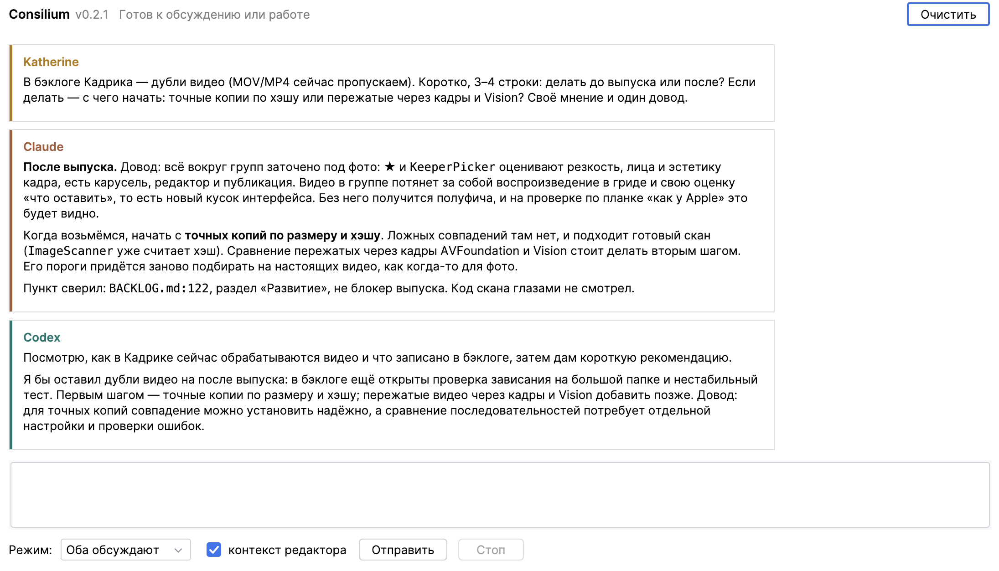

# Consilium

An IntelliJ IDEA plugin that puts one person, Claude Code, and OpenAI Codex in the same chat.

Working with two coding agents usually means two terminals and copying answers between them. Consilium keeps one shared transcript in a tool window: both agents answer the same message independently, and on the next turn each sees what the other said. When it is time to change code, you hand the repository to exactly one of them.



*Both agents answer one question independently, each with its own argument. The plugin interface is in Russian.*

**Authorship:** direction, design decisions, and review: Katherine Mironova. Implementation used Claude Code and OpenAI Codex under her direction.

## How it works

Each message goes out in one of five modes:

| Mode | Who runs | Access |
| --- | --- | --- |
| Both discuss | Claude and Codex, in parallel | read-only |
| Claude answers / Codex answers | the selected agent | read-only |
| Claude does / Codex does | the selected agent only | can edit the repository and run checks |

The one coordination rule: **only one agent may write to the repository per turn.** In a "does" turn the other agent is not started, so two agents never edit the same files at once.

How read-only is enforced:

- **Codex** runs with the `read-only` sandbox and `approval_policy="never"`, also when resuming a session. Without the second setting, an auto-approving reviewer in the user's Codex config could approve a write after the sandbox denied it.
- **Claude Code** gets only the `Read`, `Glob` and `Grep` built-in tools. MCP tools stay available, and in non-interactive mode a tool call goes through only if it is pre-approved in the user's Claude settings, so do not pre-approve MCP tools that write if you rely on read-only discussion turns.

Other details:

- Answers stream as the CLI produces them. **Stop** cancels a turn; the partial answer stays in the transcript, marked as cut off.
- In discussion modes each agent resumes its own CLI session and receives only the messages it has not seen yet. A "does" turn always starts a fresh session with the full transcript: a clean task context, with permissions set explicitly rather than inherited.
- Optional editor context attaches the open file's path and the current selection.
- The transcript is stored per project, locally.

Consilium does not talk to any API itself. It runs the official `claude` and `codex` CLIs that are already installed and signed in on your machine, so each agent keeps its own settings, skills, and MCP servers. The plugin never reads or stores tokens.

The interface text is in Russian.

## Requirements

- IntelliJ IDEA 2026.1 or newer (build 261+)
- `claude` and `codex` CLIs, installed and authenticated. The plugin looks in `~/.local/bin` first, then in `PATH`.

## Install

Download the ZIP from [Releases](../../releases), then in IDEA: **Settings → Plugins → ⚙ → Install Plugin from Disk…**, pick the ZIP, restart, and open the **Consilium** tool window on the right.

## Build from source

The build compiles against a local IDEA installation. The default path is set in `gradle.properties`; override it if yours differs:

```bash
JAVA_HOME="/Applications/IntelliJ IDEA.app/Contents/jbr/Contents/Home" \
  ./gradlew test buildPlugin -PideaPath="/Applications/IntelliJ IDEA.app"
```

The plugin ZIP lands in `build/distributions/`.

## Status

MVP, version 0.2.1. Open questions are tracked in [BACKLOG.md](BACKLOG.md).

The CLI flags the plugin passes are pinned in `CliCommandTest`, with the CLI versions they were last checked against (Claude Code 2.1.319, codex-cli 0.167.0). If a CLI upgrade makes an agent fail at launch, the error message points there. The stored transcript keeps the latest 300 messages.

## License

[MIT](LICENSE)
